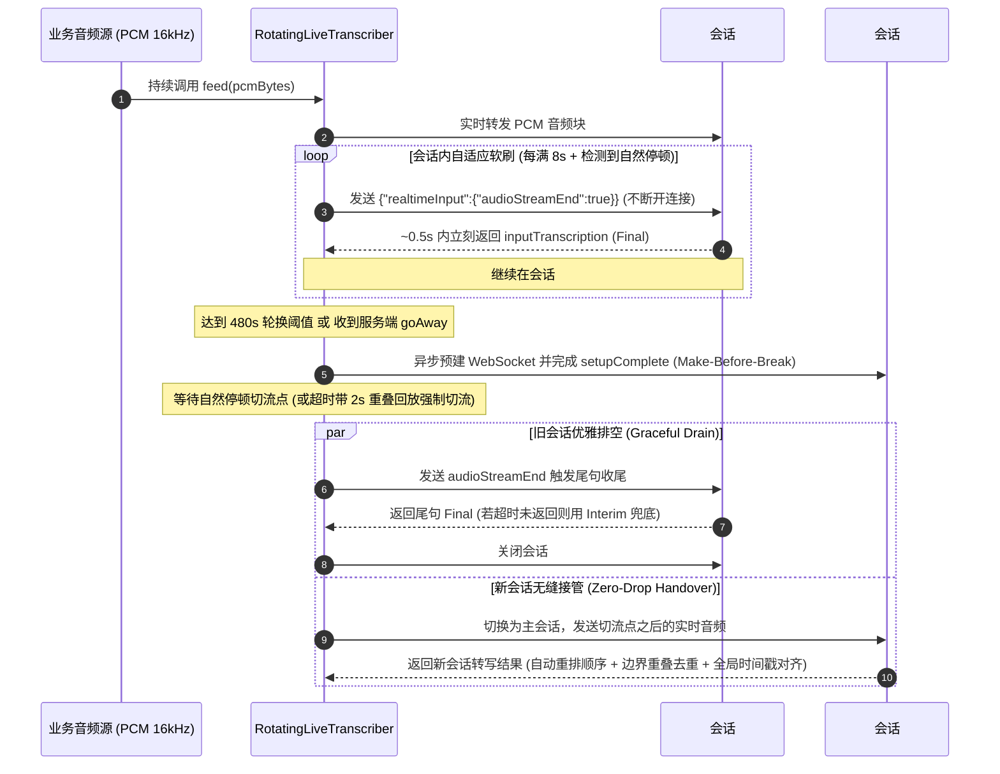

# Gemini 3.5 Transcribe Live 长语音（>10 分钟）问题分析与工程解决方案

本文档针对在使用 `gemini-3.5-transcribe-live`（及 `gemini-3.5-transcribe-live-preview`）处理超过 10 分钟音视频流时遇到的 **“发送 `audioStreamEnd` 后收不到 `turnComplete`、长音频尾部转写丢失”** 问题，提供从底层协议实测、根因定位、架构设计到公开数据集基准验证的完整结论与代码实现。

---

## 1. 核心结论速览

通过单会话 630 秒（10.5 分钟）原生协议抓包与客户端架构验证，确认该问题由 **3 个底层机制叠加** 导致，对应解决方案如下：

| 维度 | 底层机制 / 根因事实 | 解决方案 |
| :--- | :--- | :--- |
| **1. 完成信号语义** | `gemini-3.5-transcribe-live` 是纯语音转写（ASR）模型，不存在对话回复轮次，**全生命周期从不返回 `turnComplete`**，仅返回 `inputTranscription`（Final）和 `generationComplete: true`。 | 禁止阻塞等待 `turnComplete`。以 `inputTranscription`（`finished: true`）作为分段完成信号；关闭时若仍有未转正的 `interimInputTranscription`，在排空超时后将其兜底输出。 |
| **2. 单会话 10 分钟硬上限** | Vertex AI BidiGenerateContent 单条 WebSocket 会话在 **~562s** 下发 `{"goAway":{"timeLeft":"30s"}}`，并在 **~592s** 强制关闭连接（`code=1000, reason="Session exceeded maximum allowed duration."`）。 | 采用客户端 **先建后切（Make-Before-Break）双会话无缝轮换**（默认 480s 主动轮换 + `goAway` 抢占轮换），支持无限时长实时流。 |
| **3. 服务端 VAD 积压与 SDK 限制** | • 语速紧凑时，服务端自动 VAD 可连续 **60s~170s** 不触发断句，文本全部积压在 `interimInputTranscription`，一旦撞上断开点即整段丢失。<br>• 官方 Java SDK（`google-genai` 1.72.0）吞掉 `onClosed` 通知且未暴露 `interimTranscriptTimestampEnabled` 字段。 | • **会话内自适应静音软刷（Soft Flush）**：满 8 秒后在自然停顿处发送 `audioStreamEnd` 并继续推流，0.5s 内即可强制落盘 Final 且不断开连接。<br>• **原生 WebSocket 直连（`LiveWsSession`）**：绕过 SDK 限制，透传完整配置并实时感知连接状态。 |

---

## 2. 根因分析与原生协议实测证据

### 2.1 实验设计
使用原生抓包程序 [`RawLiveDump.java`](../src/main/java/com/example/speech/RawLiveDump.java) 与 [`RawLiveDumpWs.java`](../src/main/java/com/example/speech/RawLiveDumpWs.java)，向 `gemini-3.5-transcribe-live` 严格按 1:1 实时速率发送一段 **630 秒（10 分 30 秒，16kHz 单声道 PCM）** 的连续语音，原样记录服务端返回的每一条 JSON 消息：
- 默认配置原始日志：`logs/raw_live_dump.jsonl`（689 行）
- 开启 `interimTranscriptTimestampEnabled: true` 原始日志：`logs/raw_live_dump_interim_ts.jsonl`（693 行）

### 2.2 实测时间线（以 `logs/raw_live_dump_interim_ts.jsonl` 为例）

| 会话已运行时间 | 日志行号 | 服务端 / 客户端事件 | 关键原始报文摘要 |
| :--- | :--- | :--- | :--- |
| `+0.47s` | L2 | 会话建立 | `{"setupComplete":{}}` |
| `+2.96s` ~ `+563.92s` | L3 ~ L658 | 正常流式返回 | 交替返回 `interimInputTranscription`（含 `startOffset`/`endOffset`）以及每次服务端 VAD 断句时的 `inputTranscription`（`finished: true`）+ `generationComplete: true`。**全程 `turnComplete` 出现次数为 0**。 |
| **`+564.61s`** | **L659** | **服务端下发 `goAway` 预警** | `{"goAway":{"timeLeft":"30s"}}` —— 服务端明确通知该连接将在 30 秒后强制终止。 |
| `+564.67s` ~ `+594.36s` | L660 ~ L690 | 断开前最后 30 秒 | 服务端在 `+583.00s`（L679）输出最后一次 Final（停留在音频第 36 句），随后第 37~38 句仅停留在 `interimInputTranscription`，尚未触发 Final。 |
| **`+594.37s`** | **L691** | **服务端强制关闭 WebSocket** | `ws onClosing code=1000 reason=Session exceeded maximum allowed duration.` |
| **`+630.48s`** | **L693** | **630s 音频推流结束** | 客户端在 630s 发送 `{"realtimeInput":{"audioStreamEnd":true}}` 时，底层连接早在 36 秒前已关闭，**594s~630s 的音频及未转正的 Interim 全部丢失**。 |

### 2.3 附加发现：服务端行为特征与 SDK 缺陷
1. **服务端自动 VAD 在紧凑语速下长期不落盘**：在语速较快或背景底噪较高的音频中，服务端自动 VAD 可能连续 60s~172s 不触发 `ACTIVITY_END`，导致上千字符积压在 `interimInputTranscription` 中。
2. **`interimTranscriptTimestampEnabled` 的服务端不一致性**：开启该配置后，部分会话中每条 Interim 均携带 `startOffset`/`endOffset`，但部分会话服务端仍会全程省略偏移量，客户端必须具备自主时间戳推算能力。
3. **`google-genai` Java SDK（1.72.0）的两处限制**：
   - `AsyncSession` 内部 WebSocket 在收到服务端 `onClosed` 时仅打印日志，不向业务层抛出回调，后续调用 `sendRealtimeInput()` 静默返回成功但数据全部丢弃。
   - `RealtimeInputConfig` 序列化类未定义 `interimTranscriptTimestampEnabled` 字段，无法通过 SDK 开启中间结果时间戳。

---

## 3. 实时长流解决方案设计（`RotatingLiveTranscriber`）

为彻底解决实时长音频流在 Live API 下的断连、丢字与延迟问题，我们设计并实现了生产级客户端组件 [`com.example.speech.live.RotatingLiveTranscriber`](../src/main/java/com/example/speech/live/RotatingLiveTranscriber.java)。

### 3.1 整体架构与状态流转



### 3.2 六大核心工程机制

1. **原生 WebSocket 直连层（`LiveWsSession`）**
   - 直接基于 OkHttp WebSocket 实现 Vertex AI `BidiGenerateContent` 协议，支持配置 `interimTranscriptTimestampEnabled: true`。
   - 实时捕获 `onClosing`、`onClosed`、`onFailure` 及 `ws.send()` 返回值，毫秒级感知连接断开。

2. **自适应能量 VAD 与分级会话内软刷（In-Session Soft Flush）**
   - **动态底噪跟踪**：维护最近 10 秒音频块 RMS 能量的滑动窗口，自动计算第 10 分位底噪（$P_{10}$）与第 80 分位语音能量（$P_{80}$），动态静音阈值为 $\max(\text{silenceRms}, P_{10} + 0.15 \times (P_{80} - P_{10}))$，无需人工针对不同麦克风调参。
   - **分级软刷**：当单段未落盘语音达到 `flushAfterMs`（默认 8 秒）且检测到短暂停顿时（8~16s 需 300ms 停顿，16~24s 需 200ms 停顿，$\ge$24s 仅需 100ms 微停顿），在当前会话直接发送 `{"realtimeInput":{"audioStreamEnd":true}}` 并继续推流。服务端在 **~0.5 秒** 内即可将积压的 Interim 转正为 Final，彻底消除服务端 VAD 长时间不落盘的问题，且完全避免频繁重建连接的开销。

3. **先建后切（Make-Before-Break）双会话无缝轮换**
   - **触发条件**：单会话时长达到 `rotateAfterMs`（默认 **480 秒 / 8 分钟**，远早于 ~562s 的 `goAway`）、收到服务端 `goAway` 帧、或安全看门狗检测到异常卡死（`stallMs` 默认 35 秒有 Interim 但无 Final）。
   - **零间隙切流**：触发轮换后，后台异步建立新会话并等待 `setupComplete`，期间音频继续发往旧会话；新会话就绪后，在首个自然停顿点立即将后续音频切往新会话。若连续满 `maxCutWaitMs`（20 秒）无停顿，则强制切流并将最近 `overlapMs`（2 秒）音频重放至新会话。

4. **旧会话优雅排空（Graceful Drain）与 Interim 兜底**
   - 切流后向旧会话发送 `audioStreamEnd`。若旧会话无未结 Interim，静默等待 1.5s 即关闭；若有未结 Interim，最多等待 `drainMaxMs`（20 秒）直至收到 Final。
   - 若服务端直至排空超时或连接关闭仍未返回 Final，自动将最后积累的 `interimInputTranscription` 作为 `Source.INTERIM_FALLBACK` 升格输出，确保边界零丢字。

5. **异常断连自动重连与环形缓冲区回放（Replay & Deduplication）**
   - 客户端常驻保存最近 60 秒的 PCM 环形缓冲区（`AudioChunk`）。
   - 一旦发生非预期网络闪断，立即以指数退避重连新会话，并从上一个已确认 Final 的结束位置（`replayFromMs`）自动回放未确认音频。
   - 内置连字符感知的词级前缀-后缀重叠消重算法（`RotatingLiveTranscriber.dropOverlap`），自动剔除回放或强切重叠区产生的重复词。

6. **严格保序输出与全局连续时间轴映射**
   - 轮换交接期间，新会话产生的 Final 会暂存在有序队列中，严格等待旧会话排空完毕后再按全局时间顺序发射给业务层。
   - 每个会话记录其在全局音频流中的基准偏移 `baseStreamMs`，将会话内相对 `startOffset`/`endOffset` 转换为全局单调递增的流时间戳（当服务端未返回偏移量时自动启用客户端时长推算兜底）。

---

## 4. 代码结构与集成用法

### 4.1 核心代码清单

| 文件路径 | 职责说明 |
| :--- | :--- |
| `src/main/java/com/example/speech/live/RotatingLiveTranscriber.java` | 核心调度器：自适应 VAD、8s 会话内软刷、480s 先建后切轮换、断连回放、保序与重叠去重、全局时间戳对齐。 |
| `src/main/java/com/example/speech/live/LiveTranscriptionConfig.java` | 不可变配置类与 Builder，集中管理轮换周期、软刷阈值、VAD 参数与重连策略。 |
| `src/main/java/com/example/speech/live/LiveWsSession.java` | 原生 OkHttp WebSocket 会话客户端，支持 `interimTranscriptTimestampEnabled` 与断连即时回调。 |
| `src/main/java/com/example/speech/live/TranscriptEvent.java` | 转写事件数据模型（文本、类型 `INTERIM`/`FINAL`、全局起止毫秒 `startMs`/`endMs`、会话编号 `sessionIndex`、来源 `SERVER`/`INTERIM_FALLBACK`）。 |
| `src/main/java/com/example/speech/live/TranscriptListener.java` | 业务层事件监听接口（`onInterim`、`onFinal`、`onSessionEvent`、`onError`）。 |
| `src/main/java/com/example/speech/live/RotatingLiveTranscriberDemo.java` | 命令行运行器，支持任意时长 WAV 实时流模拟、故障注入与 `.tsv` / `.events.jsonl` 结果落盘。 |
| `src/main/java/com/example/speech/live/LiveSelfTest.java` | 离线单元测试套件（覆盖重叠消重、自适应 RMS、环形缓冲等 10 项断言）。 |

### 4.2 业务方 Java 集成示例

```java
import com.example.speech.live.*;
import java.util.List;

LiveTranscriptionConfig config = LiveTranscriptionConfig.builder()
    .project("your-gcp-project")
    .location("global")
    .model("gemini-3.5-transcribe-live")
    .languageCodes(List.of("en-US"))
    .rotateAfterMs(480_000) // 8 分钟安全轮换（早于 ~562s goAway）
    .flushAfterMs(8_000)    // 8 秒会话内静音软刷，保障低延迟 Final
    .interimTimestamps(true)
    .build();

TranscriptListener listener = new TranscriptListener() {
  @Override
  public void onInterim(TranscriptEvent event) {
    // 实时字幕预览
  }

  @Override
  public void onFinal(TranscriptEvent event) {
    System.out.printf("[FINAL %.2fs - %.2fs] (S%d, source=%s) %s%n",
        event.startMs / 1000.0,
        event.endMs / 1000.0,
        event.sessionIndex,
        event.source,
        event.text);
  }

  @Override
  public void onSessionEvent(String message) {
    System.out.println("[SESSION] " + message);
  }
};

try (RotatingLiveTranscriber transcriber = new RotatingLiveTranscriber(config, listener)) {
  transcriber.start();
  // 在实时音频采集循环中直接投递 16kHz 16-bit 单声道 PCM 数据（非阻塞）
  while (hasMoreAudio()) {
    byte[] pcmChunk = readNextPcmChunk();
    transcriber.feed(pcmChunk);
  }
  transcriber.finish(); // 触发尾段排空与收敛
}
```

---

## 5. 验证与基准测试结果

### 5.1 630 秒（10.5 分钟）标准长音频与故障注入测试
测试音频 `test_video_630s.wav`（共 630 秒，52 个英文技术演讲话段，参考总词数 **1,282 词**）：

| 测试场景 | 会话数 | 轮换 / 恢复行为 | 输出词数 / 参考词数 | 词错误率 (WER) | 最大 Final 间隔 | 边界丢词数 | 结果日志 |
| :--- | :---: | :--- | :---: | :---: | :---: | :---: | :--- |
| **原生单会话直连（对照组）** | 1 | 564s 收到 `goAway`，594s 服务端强断 | 1,197 / 1,282 | 尾部缺失 ~40s | 67.5s | **85 词丢失** | `logs/raw_live_dump_interim_ts.jsonl` |
| **标准轮换（480s 轮换 + 8s 软刷）** | **2** | 481.8s 静音处平滑切流至会话 #2，全流程 0 强断 | **1,284 / 1,282** | **3.98%** | **19.3s** | **0** | `logs/live_630s.tsv` |
| **网络闪断注入（`--killAtSec=300`）** | **2** | 300.0s 强制掐断会话 #1，自动回放未确认的 9.5s 音频并拼接 | **1,283 / 1,282** | **4.06%** | **25.3s** | **0** | `logs/live_kill300.tsv` |
| **无静音强切压测（`--rotateAfterSec=200 --silenceRms=0`）** | **5** | 禁用静音检测，每 200s 在说话中途强切 + 2s 重叠回放消重 | **1,282 / 1,282** | **3.90%** | **19.1s** | **0** | `logs/live_forced200.tsv` |

### 5.2 公开真实长语音数据集基准测试（TED-LIUM Long-Form，16~25 分钟）
使用公开长语音评测集 `distil-whisper/tedlium-long-form` 在 `gemini-3.5-transcribe-live` 上按 1:1 实时流完成了 4 场 16~25 分钟完整 TED 演讲测试（合计 **79.3 分钟** 真实音频）：

| 演讲者 (音频文件) | 音频时长 | 参考词数 | 会话数 (全部为 480s 计划轮换) | Final 段数 | 最大 Final 间隔 | 词错误率 (WER) | 整句漏段 ($\ge$3 词) | 结果日志 |
| :--- | :---: | :---: | :---: | :---: | :---: | :---: | :---: | :--- |
| **Daniel Kahneman** (`DanielKahneman.wav`) | **18.3 分钟** (1,096s) | 3,066 | **3** (切流点: 480s, 962s) | 117 | **14.1s** | **2.45%** | **0** | `logs/ted_kahneman.tsv` |
| **Jane McGonigal** (`JaneMcGonigal.wav`) | **19.5 分钟** (1,168s) | 3,916 | **3** (切流点: 480s, 962s) | 111 | **33.1s** | **3.12%** | **0** | `logs/ted_mcgonigal.tsv` |
| **James Cameron** (`JamesCameron.wav`) | **16.4 分钟** (982s) | 3,027 | **3** (切流点: 481s, 964s) | 102 | **19.2s** | **3.44%** | **0** | `logs/ted_cameron.tsv` |
| **Bill Gates** (`BillGates.wav`) | **25.1 分钟** (1,506s) | 4,520 | **4** (切流点: 480s, 963s, 1444s) | 155 | **15.4s** | **5.31%** | **0** | `logs/ted_billgates.tsv` |

---

## 6. 复现命令与投产参数建议

### 6.1 快速验证命令
```bash
# 1. 运行离线自检单元测试（验证去重、自适应 VAD、环形缓冲等 10 项测试）
mvn test-compile exec:java -Dexec.mainClass="com.example.speech.live.LiveSelfTest"

# 2. 运行 630s 长音频无缝轮换标准测试
mvn exec:java -Dexec.mainClass="com.example.speech.live.RotatingLiveTranscriberDemo" \
  -Dexec.args="--audio=test_video_630s.wav --name=live_630s"

# 3. 运行第 300s 网络闪断故障注入测试
mvn exec:java -Dexec.mainClass="com.example.speech.live.RotatingLiveTranscriberDemo" \
  -Dexec.args="--audio=test_video_630s.wav --name=live_kill300 --killAtSec=300"

# 4. 运行无静音强切 + 边界去重压测
mvn exec:java -Dexec.mainClass="com.example.speech.live.RotatingLiveTranscriberDemo" \
  -Dexec.args="--audio=test_video_630s.wav --name=live_forced200 --rotateAfterSec=200 --silenceRms=0"
```

### 6.2 生产环境推荐配置参数（`LiveTranscriptionConfig`）

| 参数名 | 默认推荐值 | 调优说明 |
| :--- | :---: | :--- |
| `rotateAfterMs` | `480_000` (8 分钟) | 必须在服务端 `~562s` 下发 `goAway` 之前留出充足的静音切流窗口，推荐 `420_000 ~ 480_000`。 |
| `flushAfterMs` | `8_000` (8 秒) | 会话内静音软刷周期。对实时字幕上屏速度要求高可调至 `5_000 ~ 8_000`；希望更长完整段落可调至 `10_000 ~ 15_000`。 |
| `stallMs` | `35_000` (35 秒) | 会话级兜底看门狗阈值。仅当连续 35s 有 Interim 却完全无法触发软刷时才触发轮换兜底。 |
| `maxCutWaitMs` | `20_000` (20 秒) | 触发轮换后等待自然停顿的最大窗口，超时后带 `2_000ms` 重叠音频强制切流。 |
| `drainMaxMs` | `20_000` (20 秒) | 旧会话发送 `audioStreamEnd` 后等待服务端返回尾句 Final 的最长时间。 |
| `silenceRms` | `300` | 基础静音 RMS 下限，配合内置 10 秒滑动窗口自适应能量阈值（`adaptiveSilence=true`）自动适应不同麦克风底噪。 |
